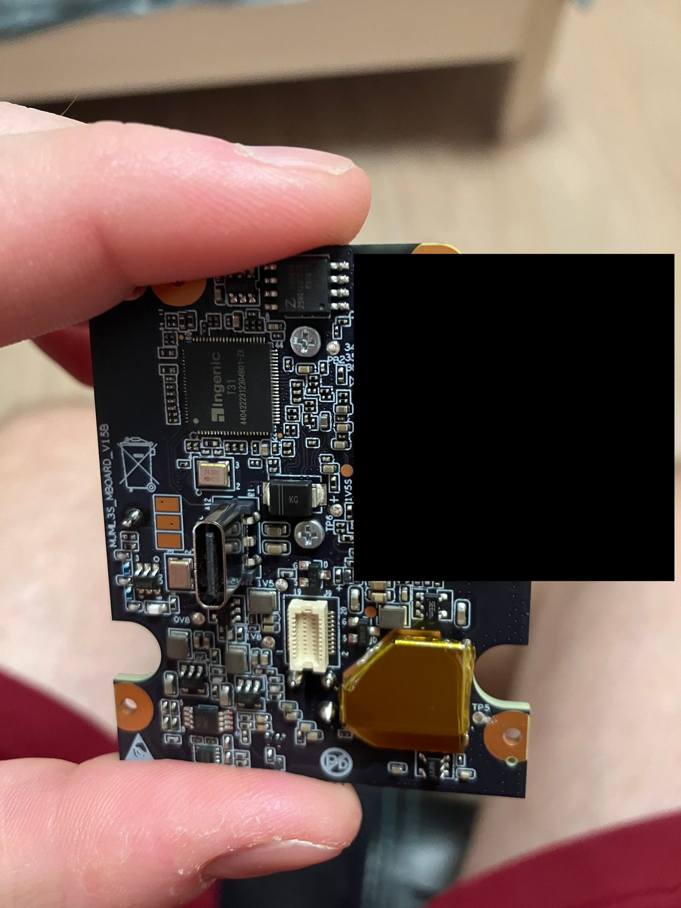
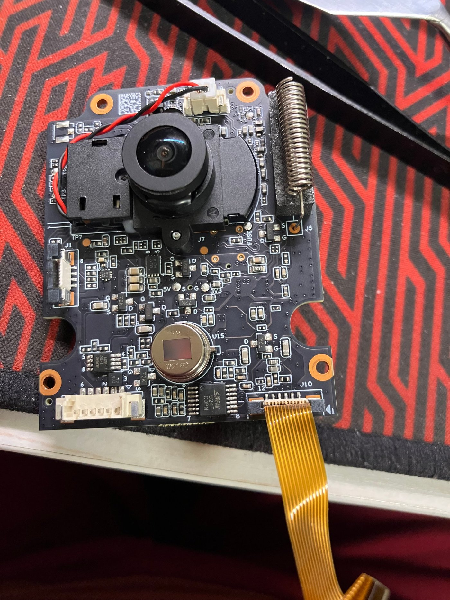
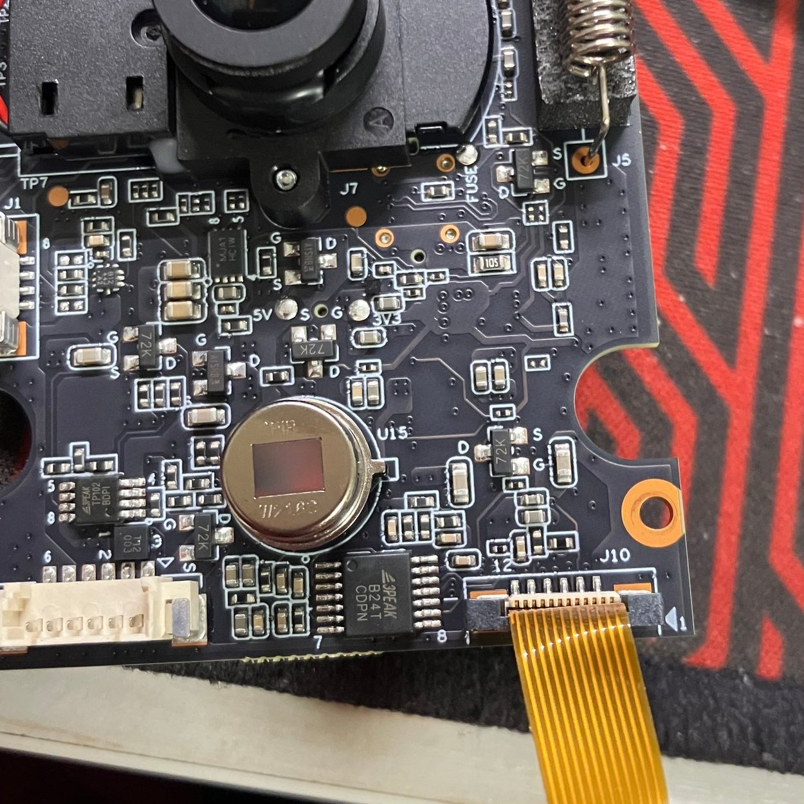
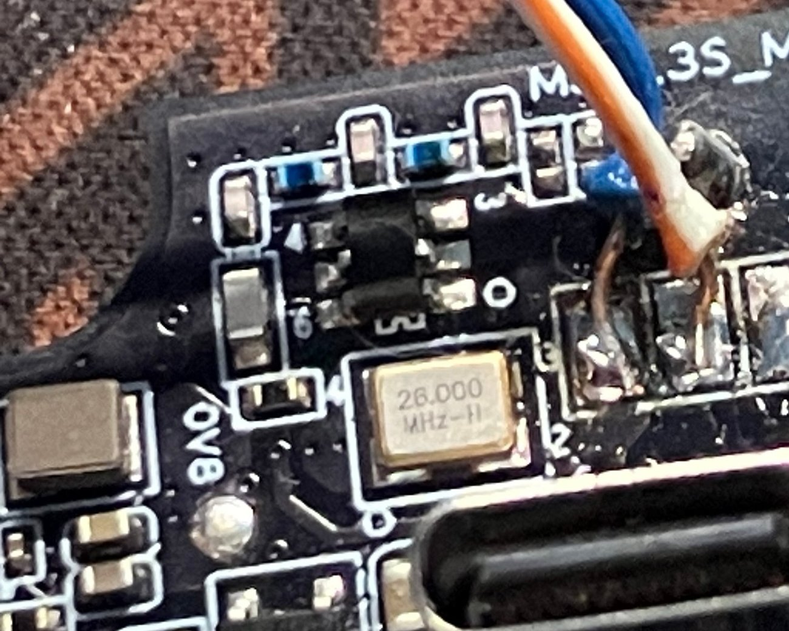
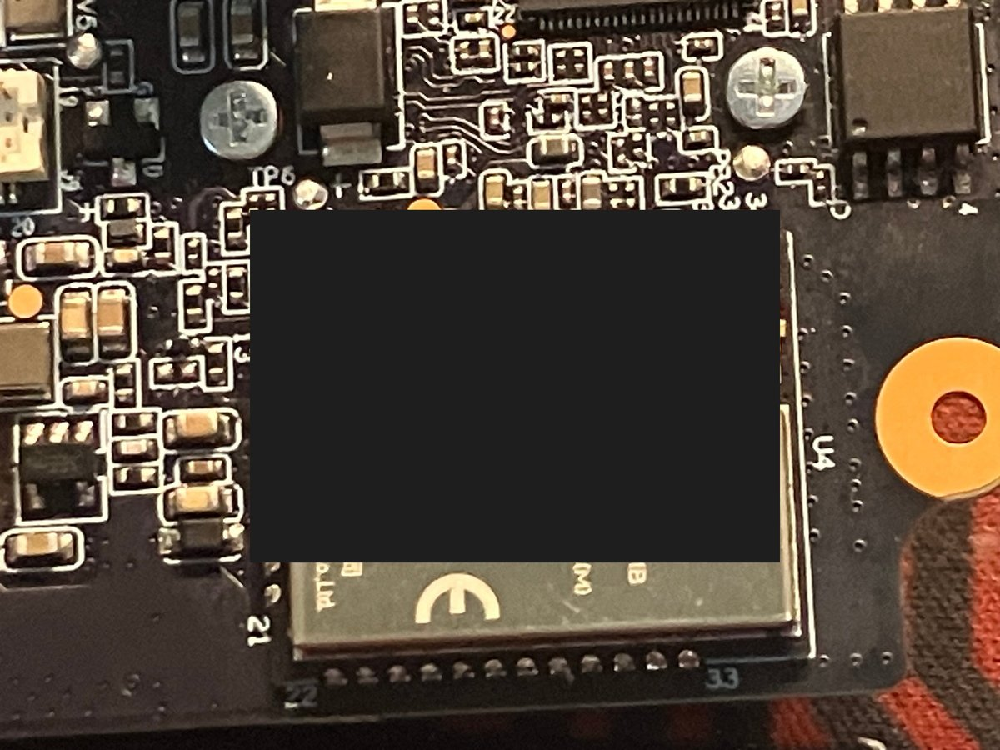

# Hardware

## Components

| Part | Details |
|---|---|
| SoC | Ingenic **T31** (T31ZX variant), MIPS32r2 little-endian |
| RAM | 64 MiB DDR2 (`mem=72M` in the kernel command line, part reserved as rmem) |
| Camera | SmartSens **SC301IoT**, 3 MP |
| Wi-Fi/BT | **Bouffalo Lab BL616** inside the `MSHWB01L-IB` module (SDIO, `blwnet.ko`, `blctld`/`blctl`, u.FL antenna connector) |
| Flash | **Zbit ZB25VQ128**, 16 MiB SPI NOR (JEDEC `0x5E4018`) |
| Power | Li-ion battery + charging board, USB-C |
| Audio | I2S codec, speaker / microphone |
| Power management | no separate controller chip: the module above also handles power on/off and the event sources (see below) |

## Board photos


*The Ingenic T31 SoC (T31ZX marking on the package).*


*Flash chip area with numbered test pads; useful for locating the SOIC-8 flash
and the debug pads.*

## Power and "sleep"

This is a battery-powered doorbell: the MCU keeps the SoC **off** until an event
happens. PIR motion, the doorbell button or the cloud wake the T31; it boots,
checks for events and, if there is nothing to do, the MCU powers the SoC off
again a few seconds later (`send soc power off` in the application log). The
Wi-Fi chip and the MCU stay alive.

That is why "reboots every 10–50 s" in the logs are **normal behaviour**, not a
failure. If you need a persistent channel (SSH / OTA / MQTT), keep the SoC awake
(see the `fj_system_soc_powerOff` patch in
[docs/03-firmware-format.md](03-firmware-format.md)); in that case the device
must be powered from USB-C / the charging board, because an always-on SoC drains
the battery quickly.

## Debug pads

There are two test pads on the board (call them A and B). Pad **A is UART1**
(the U-Boot and kernel console): on power-up it shows the bootloader banner
`Ver:...-Turret`, and after the `cmdline` patch it also shows the full kernel log
and a console.

Parameters: **115200 8N1, 3.3 V**. Wiring: `adapter RXD → pad A`,
`adapter GND → board GND`. See [docs/06-uart-console.md](06-uart-console.md).

## Flash and programmer

The flash is a plain SPI NOR in a SOIC-8 package. To read or write it:

- a **CH341A** programmer in programmer mode (jumper set to the programmer side);
- a SOIC-8 clip (or wires soldered to the pads);
- the board must be **fully unpowered** (battery disconnected, USB unplugged),
  otherwise the chip does not respond reliably;
- clip contact is the weak point: `No EEPROM/flash device found` and
  `LIBUSB_TRANSFER_TIMED_OUT` usually mean bad contact, not a dead chip.

Typical 25-series SOIC-8 pinout:

```
1 CS   8 VCC
2 DO   7 HOLD
3 WP   6 CLK
4 GND  5 DI
```

## Warnings

- Never power the board while the programmer is attached.
- Before any experiment, take a **full flash dump** and verify its sha256.
- For mains-powered operation use the original charging board.

## Programmer 3.3 V note

Some CH341A boards drive the SPI lines at 5 V even in 3.3 V mode. If your
programmer is one of those, consider the hardware fix documented by others:
[OpenIPC wiki](https://github.com/OpenIPC/wiki/blob/master/en/hardware-programmer-ch341a-voltage-fix.md),
[thingino wiki](https://github.com/themactep/thingino-firmware/wiki/CH341a-programmer).

## Board revision

The PCB is marked `MJML3S_MBOARD_V15B`. No dedicated controller (MCU) chip is
present on either side of the board:

- the only large ICs are the T31 SoC and the flash chip;
- the two crystals are **24.000 MHz** (next to the SoC) and **26.000 MHz**
  (next to the USB-C connector); there is no 32.768 kHz RTC crystal, which a
  dedicated low-power controller would normally need;
- the remaining small parts are load switches and regulators for the
  5 V / 3.3 V / 2.8 V / 1.5 V / 0.8 V rails, plus a pyroelectric PIR sensor,
  the camera module and the battery connector.

## Where the control logic lives

The board has three functional blocks, not four:

| Block | Role | Evidence |
|---|---|---|
| Ingenic T31 | Linux, application, video pipeline, our control channel | kernel, `doorbell.out`, `imp_sync_server` |
| Zbit ZB25VQ128 | firmware storage (boot, tag, kernel, rootfs slots, config) | read/written with an external programmer |
| `MSHWB01L-IB` module (BL616) | Wi-Fi/BT **and** power/event controller | UART0 is used by both the MCU daemon (`agent`) and the Wi-Fi daemon (`blctld`); the module holds the cloud session even when Linux has no address (TTL 255 ICMP replies, vendor connections); Bouffalo *NetHub* firmware allows a private control flow over UART/SDIO |

So the "MCU" of this device is a role played by the module's firmware: it keeps
the device reachable, powers the SoC on and off, reads the button and the PIR
sensor, and talks to the application over `UART0` with a short binary framing
(`0x7B` header, length, command, payload, XOR).

This matters for custom firmware: the control path can be reused through the
existing `agent` daemon (battery, button, PIR, LED, power), and replacing only
the vendor application does not require reverse-engineering the MCU protocol.

## Board photos


*The Ingenic T31 SoC. The PCB is marked `MJML3S_MBOARD_V15B`.*



*Component side: the T31 SoC, the SPI flash, the 24.000 MHz crystal near the
SoC, the USB-C connector, the `MSHWB01L-IB` module (label redacted) with its
u.FL antenna connector, and the load switches for the 5 V / 3.3 V / 2.8 V /
1.5 V / 0.8 V rails.*



*Camera side: the camera module on a flex cable, the pyroelectric PIR sensor in
its metal can, the button/spring contact and the battery connector.*



*Close-up of the PIR sensor and the load switches around it (`5V`, `3V3`,
`0V8`, `1V5`, `2V8` rail markings).*



*USB-C connector and the 26.000 MHz crystal next to it.*



*The `MSHWB01L-IB` Wi-Fi/BT module (BL616 inside). The printed label with the
device MAC address is redacted.*
