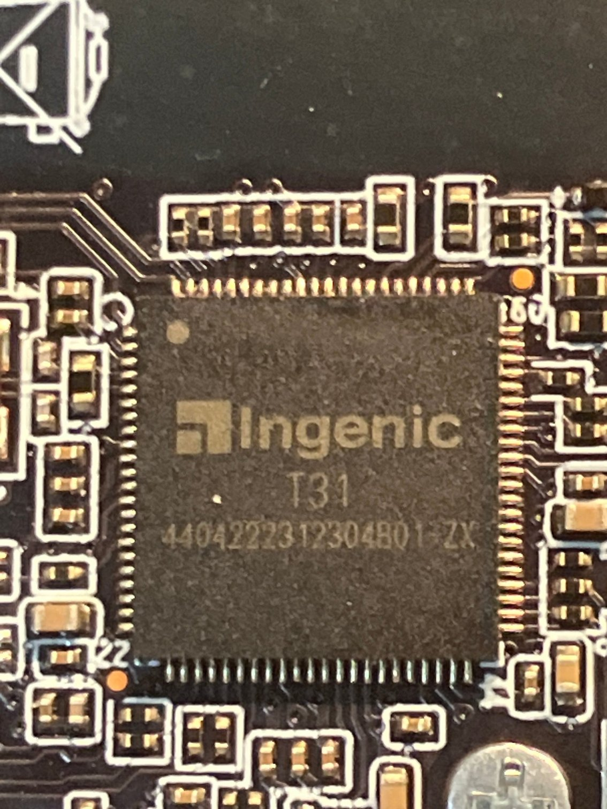
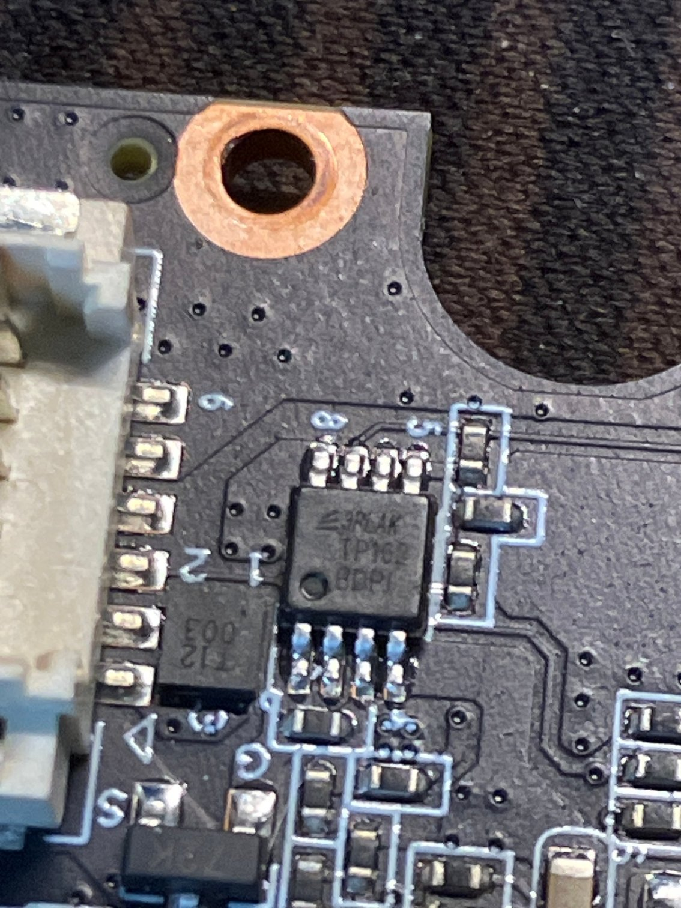

# Hardware

## Components

| Part | Details |
|---|---|
| SoC | Ingenic **T31** (T31ZX variant), MIPS32r2 little-endian |
| RAM | 64 MiB DDR2 (`mem=72M` in the kernel command line, part reserved as rmem) |
| Camera | SmartSens **SC301IoT**, 3 MP |
| Wi-Fi | **Bouffalo Lab BL616** (SDIO, `blwnet.ko`, `blctld`/`blctl`) |
| Flash | **Zbit ZB25VQ128**, 16 MiB SPI NOR (JEDEC `0x5E4018`) |
| Power | Li-ion battery + charging board, USB-C |
| Audio | I2S codec, speaker / microphone |
| Power management | a separate MCU: powers the SoC on/off and monitors the battery |

## Board photos



*The Ingenic T31 SoC (T31ZX marking on the package).*



*Flash chip area with numbered test pads; useful for locating the SOIC-8 flash
and the debug pads.*

## Power and "sleep"

This is a battery-powered doorbell: the MCU keeps the SoC **off** until an event
happens. PIR motion, the doorbell button or the cloud wake the T31; it boots,
checks for events and, if there is nothing to do, the MCU powers the SoC off
again a few seconds later (`send soc power off` in the application log). The
Wi-Fi chip and the MCU stay alive.

That is why "reboots every 10–50 s" in the logs are **normal behaviour**, not a
failure. If you need a persistent channel (SSH / OTA / MQTT), keep the SoC awake
(see the `fj_system_soc_powerOff` patch in
[docs/03-firmware-format.md](03-firmware-format.md)); in that case the device
must be powered from USB-C / the charging board, because an always-on SoC drains
the battery quickly.

## Debug pads

There are two test pads on the board (call them A and B). Pad **A is UART1**
(the U-Boot and kernel console): on power-up it shows the bootloader banner
`Ver:...-Turret`, and after the `cmdline` patch it also shows the full kernel log
and a console.

Parameters: **115200 8N1, 3.3 V**. Wiring: `adapter RXD → pad A`,
`adapter GND → board GND`. See [docs/06-uart-console.md](06-uart-console.md).

## Flash and programmer

The flash is a plain SPI NOR in a SOIC-8 package. To read or write it:

- a **CH341A** programmer in programmer mode (jumper set to the programmer side);
- a SOIC-8 clip (or wires soldered to the pads);
- the board must be **fully unpowered** (battery disconnected, USB unplugged),
  otherwise the chip does not respond reliably;
- clip contact is the weak point: `No EEPROM/flash device found` and
  `LIBUSB_TRANSFER_TIMED_OUT` usually mean bad contact, not a dead chip.

Typical 25-series SOIC-8 pinout:

```
1 CS   8 VCC
2 DO   7 HOLD
3 WP   6 CLK
4 GND  5 DI
```

## Warnings

- Never power the board while the programmer is attached.
- Before any experiment, take a **full flash dump** and verify its sha256.
- For mains-powered operation use the original charging board.

## Programmer 3.3 V note

Some CH341A boards drive the SPI lines at 5 V even in 3.3 V mode. If your
programmer is one of those, consider the hardware fix documented by others:
[OpenIPC wiki](https://github.com/OpenIPC/wiki/blob/master/en/hardware-programmer-ch341a-voltage-fix.md),
[thingino wiki](https://github.com/themactep/thingino-firmware/wiki/CH341a-programmer).
