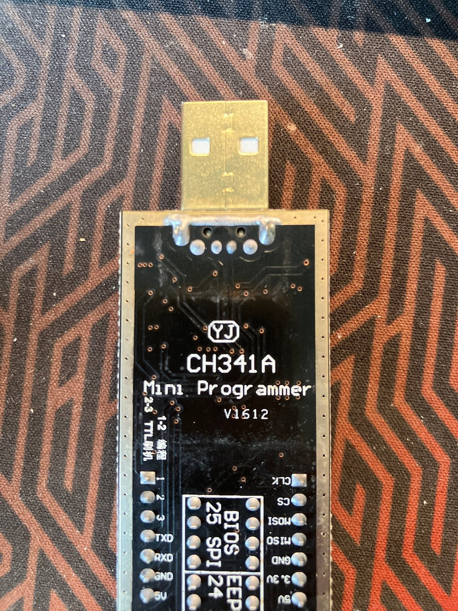
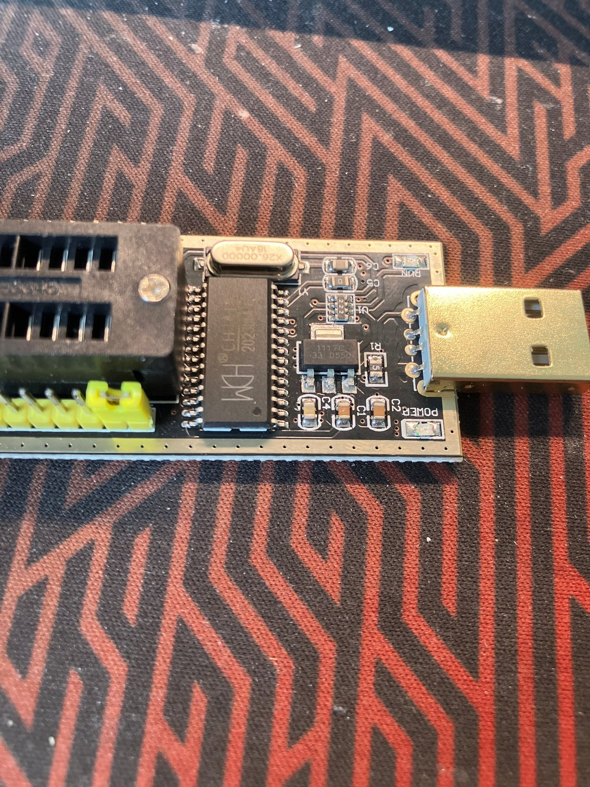
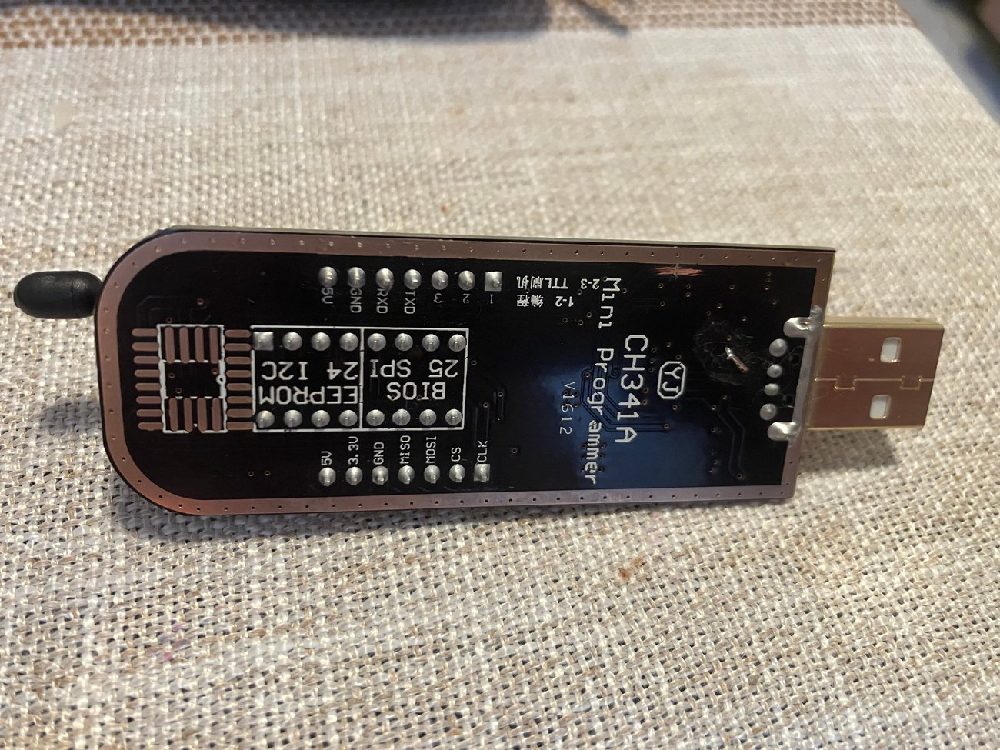
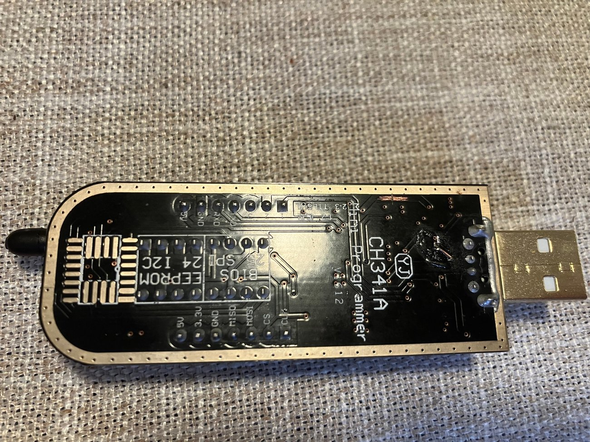
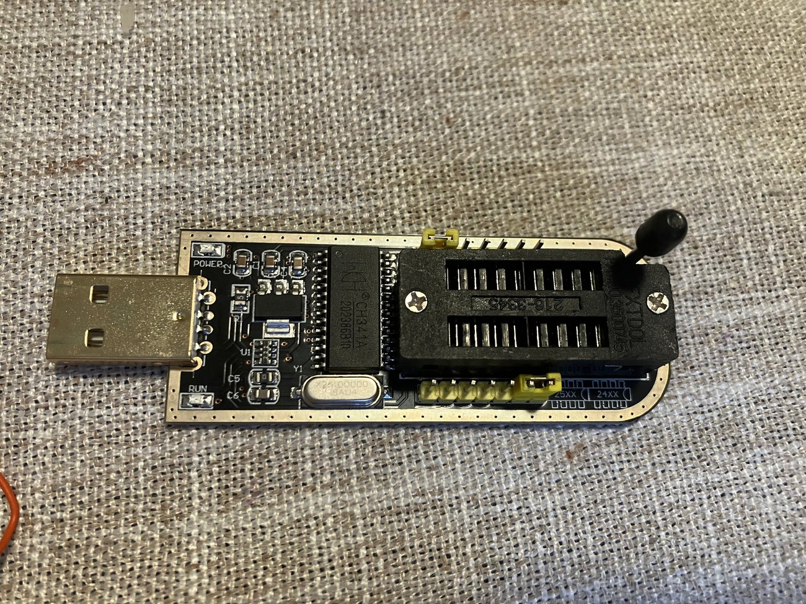
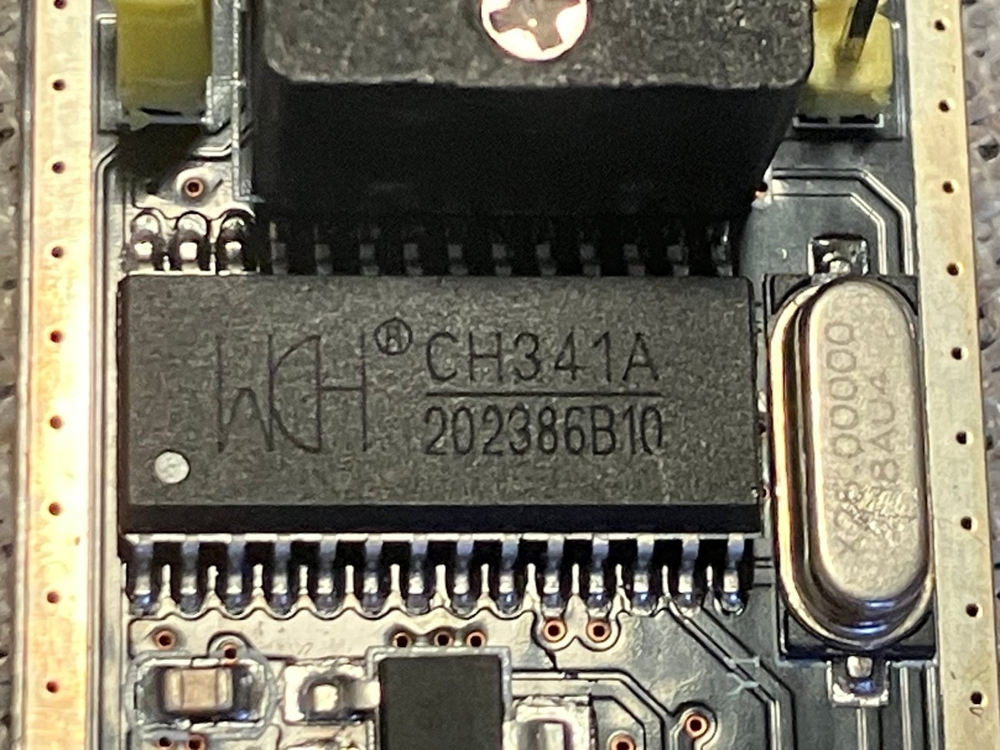
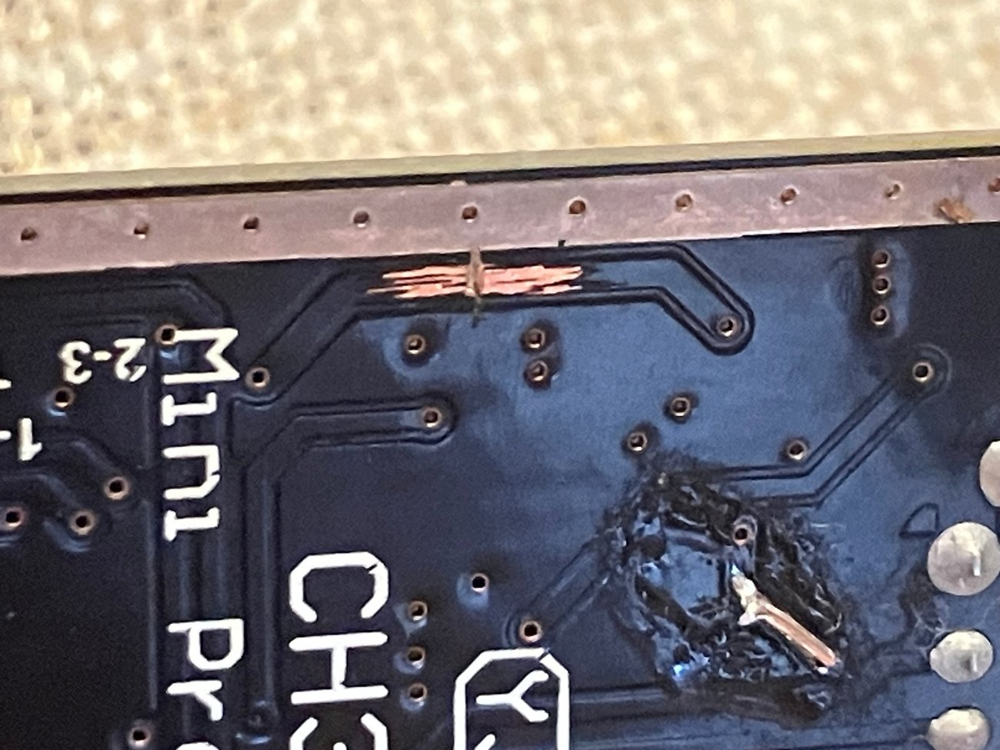

# Flashing

## Safety

- Power the board **off** (battery disconnected, USB unplugged) before attaching
  the clip to the flash chip.
- Take a full 16 MiB dump first and keep it in several places.
- Flashing only the rootfs slots is the usual workflow; the bootloader, tag,
  kernel and calibration data stay untouched.

## Programmer setup



*CH341A Mini Programmer: `1-2` selects programmer (flash) mode, `2-3` selects
TTL/UART mode. Flash operations use `1-2`.*



*CH341A with the SOIC-8 clip attached. The clip must sit firmly on the flash
chip; the board must be unpowered.*

## Reading the flash

```bash
sudo flashrom -p ch341a_spi -r stock.bin
sha256sum stock.bin
```

If the chip is not detected (`No EEPROM/flash device found`,
`LIBUSB_TRANSFER_TIMED_OUT`), reseat the clip, try another USB port, or reload
the CH341 module:

```bash
sudo modprobe -r spi_ch341; sudo modprobe -r ch341
```

## Flash layouts

`flashrom` layout files restrict the operation to selected regions:

```
# rootfs layout (both slots)
002c8000:007b7fff rootfs
007b8000:00ca7fff rootfs1
```

```
# tag-only layout (needed to change the kernel command line)
00040000:00097fff tag
```

## Flashing the rootfs (A+B)

```bash
sudo flashrom -p ch341a_spi \
  -l rootfs.layout -i rootfs -i rootfs1 \
  -w image.bin
```

## Flashing a single slot

```bash
./tools/flash-slot.sh rootfs  image.bin   # slot A
./tools/flash-slot.sh rootfs1 image.bin   # slot B
```

This is useful for the A/B experiments described in
[docs/08-ab-slots.md](08-ab-slots.md).

## Flashing the tag (console change)

```bash
sudo flashrom -p ch341a_spi -l tag.layout -i tag -w image.bin
```

Only the two `CMDL` copies inside the tag are modified by the console patch, so
the calibration blocks (`SENS`, `SSET`) remain intact.

## Tag patch tool

Instead of editing bytes by hand, patch the tag of your own dump:

```bash
./tools/patch-tag-cmdline.py your-dump.bin your-dump-console.bin
```

It changes `console=ttyS3` to `console=ttyS1` and removes `quiet` in both CMDL
copies. The tag holds per-device data, so always patch **your own** dump.

## Verification

Always verify by regions, not the whole chip — the bootloader writes flags
outside the rootfs area, so a whole-chip verify reports a mismatch:

```bash
sudo flashrom -p ch341a_spi \
  -l rootfs.layout -i rootfs -i rootfs1 \
  -v image.bin
```

Expected output: `Verifying flash... VERIFIED.`

## Recovery

If the device does not boot, re-flash the known-good dump:

```bash
sudo flashrom -p ch341a_spi -w stock.bin
```

The bootloader has two rootfs slots and falls back to the second one if the
first fails to load; see [docs/08-ab-slots.md](08-ab-slots.md).

## See also: 3.3 V level fix (external, not our work)

Early CH341A Mini Programmer boards (before ver. 1.7) keep about **5 V on the SPI
data lines** even when the jumper is set to 3.3 V, which can damage the flash
chip. A hardware modification for this is documented by other people; we do not
reproduce those instructions here:

- [OpenIPC wiki — CH341A programmer: fixing the high-voltage bug](https://github.com/OpenIPC/wiki/blob/master/en/hardware-programmer-ch341a-voltage-fix.md)
- [thingino wiki — CH341A programmer](https://github.com/themactep/thingino-firmware/wiki/CH341a-programmer)

Credits for that modification belong to their authors; this project only links
to them.

## The programmer used for this project



*Black `CH341A Mini Programmer` (USB-A): 24Cxx EEPROM pads, 25-series SPI
pads and a TTL serial header. This is the board used for the dumps in this
repository.*



*Back side of the same board.*



*Blue CH341A board with a ZIF-16 socket. Handy for a SOIC-8 clip adapter, but
it is the same chip and the same limitation (5 V on the data lines).*



*The CH341A chip and its 12 MHz crystal.*



*Our 3.3 V modification: the trace that feeds the 5 V level to the SPI lines is
cut and reworked, so the flash chip is driven from 3.3 V. Do this only if you
are comfortable with a knife and a soldering iron — otherwise buy a programmer
that is 3.3 V from the factory.*

**Warning:** a cut trace is permanent. Verify the voltages with a multimeter
before connecting a flash chip, and never power the doorbell board while the
clip is attached.
